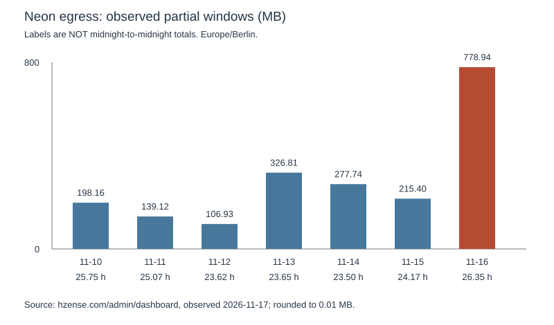

# 昨天为什么接近 1 GB：Neon 流量分析

**结论：[事实] 仪表盘“11 月 16 日”的 778.94 MB 覆盖 26 小时 21 分钟，不能视为自然日总量。[推断] 当前最有证据的流量放大源，是公开资源/人物页面的动态渲染反复读取完整信号目录，叠加爬虫访问。昨天各来源占比尚不能精确还原。**

核查时间：2026-11-17；时区 Europe/Berlin。来源与代码位置见 [sources.md](../sources.md)。本报告只分析已观测的聚合数值，不修改业务代码或生产配置。

## 每日数值与统计口径

| 仪表盘标签 |          流量 | 实际统计区间（Berlin）        |
| ---------- | ------------: | ----------------------------- |
| 11/12      |     106.93 MB | 11/12 04:43 → 11/13 04:20     |
| 11/13      |     326.81 MB | 11/13 04:20 → 11/14 03:59     |
| 11/14      |     277.74 MB | 11/14 03:59 → 11/15 03:29     |
| 11/15      |     215.40 MB | 11/15 03:29 → 11/16 03:39     |
| 11/16      | **778.94 MB** | **11/16 03:39 → 11/17 06:00** |

[事实] 所有这些行均为部分区间。午夜定时采样的 GitHub Actions 实际启动延后；代码在缺少午夜附近样本时保留真实边界并降级为部分区间。“11/16”遗漏当天凌晨，却包含 11/17 凌晨。778.94 MB = 0.779 GB；本月累计 4.24 GB 也是不同口径，不能混为一谈。

[计算] 该区间平均 **29.56 MB/小时**，前一区间 **8.91 MB/小时**，比值 **3.32**。即便仅用恒定速率情景折算为 24 小时，仍有约 709.47 MB；这不是自然日实测值，只说明增长不能仅由多出的 2 小时 21 分钟解释。

## 公开访问怎样放大数据库流量

[事实] 当前公开信号 184 条，完整 `content` JSON 文本合计 **303852 字节，约 0.304 MB**。资源详情和人物详情不是只查这个实体的关联信号，而是先读完整公开信号目录，再在应用中关联实体。页面使用 `force-dynamic`；React `cache` 只在一次服务端渲染内去重，不能在不同访客请求之间复用目录。

[事实] Vercel 当前可见的最近 12 小时（**11/17 04:31–16:31，不是昨天**）约 2.5K CDN 请求，其中：

| 路由                       | 请求数 | CDN 缓存命中率 |
| -------------------------- | -----: | -------------: |
| 资源详情 `/resources/[id]` |    550 |             0% |
| 信号详情 `/signals/[id]`   |    514 |             0% |
| 人物详情 `/persons/[id]`   |    478 |             0% |
| 专题详情 `/topics/[id]`    |    268 |             0% |
| 首页 `/`                   |    173 |             0% |

[事实] 同窗口已识别机器人请求合计 **839**，其中 GoogleOther 586、FacebookExternalHit 149、PetalBot 42。这些是机器人分组，不可与路由分组相加；未识别流量也不能直接认定为人类或恶意流量。

[情景估算] 仅资源和人物详情的 1028 次请求，若每次都执行一次全量目录读取，JSON 正文传输即为 **312.36 MB**。约 2564 次这样的目录读取便相当于 778.94 MB。计算未包含其他列、协议开销、权限查询和洞察报告；也未证明每个 CDN 请求都实际执行了 SQL，不应作为昨天实测分摊或保证可节省的金额。

[推断] “网站内容不多”并不意味着流量少。数据库收费流量会随重复读取次数累积，爬虫逐个访问资源与人物页面时，这条路径能产生与本次异常同量级的传输。这是优先优化对象。

## AI 与后台任务是否导致异常

[事实] 11/16 自然日创建了 8 个生成任务，当前均已完成、失败 0 个；snapshot 共 227495 字节。仪表盘跨日区间内则创建了 17 个任务，当前 14 完成、3 失败，snapshot 共 471737 字节。这证明不能把跨日流量直接与自然日任务数对应。

[代码事实] 生成任务的若干状态转换会重新读取完整 snapshot/result，创建、执行、校验和自动发布还会读取资料。这确有固定次数的重复传输，应改为按用途读取字段。但任务数量和原始快照总量本身不足以证明几百 MB 的增量都来自 AI。

[代码事实] 普通后台任务轮询已使用 15 秒间隔、页面隐藏暂停和精简状态投影，不是每 5 秒反复下载完整原文。仍存在一个历史审核/补全页面的 5 秒刷新路径，但近期补全任务为 0，当前没有证据把它归为昨天主要原因。

## 优化顺序

1. **公开页按需读库。** 资源/人物详情直接查询关联信号，列表只读取需要的摘要与关联字段；雷达读聚合结果；完整正文留到详情。兼容旧名称关系的路径需单独保留，不能破坏已有匹配。
2. **让公开数据跨请求复用。** 增加短期缓存并在发布、修改、撤回后失效；继续保证撤回即时可见、只读权限与就绪门禁，不能为省流量跳过这些校验。洞察目录也应拆分摘要与报告全文读取。
3. **修正每日统计与补齐归因。** 不把跨日样本差值展示成完整自然日；可靠保存午夜基线，缺样时明确“区间流量”。记录各业务查询的次数和响应字节聚合，避免保存原文或敏感参数。需要供应商历史小时指标时，先核对当前套餐/API 可用性。
4. **减少后台固定重复读取。** 状态转换只取状态、版本、费用等必要字段，避免反复取 snapshot/result；原文完整性校验不降低。

优先级不等于已经实施。本次仅核查，没有禁止爬虫、开启缓存、改动数据库或重跑付费 AI。

## 反面观点、风险与尚未解决的问题

- **昨天网站访问模式可能不同。** 目前 Vercel 页面仅能查看最近 12 小时，运行日志仅有 1 小时回看；今天的路由/机器人分布不能代替昨天。后台人工操作、SQL Editor 和其他连接也可能贡献流量。
- **没有昨日 SQL 次数。** 数据库未安装 `pg_stat_statements`，且 compute 已重新启动；当前不能事后精确归因每个查询。即使以后启用查询统计，也需要按时间保存差分并将字节估算与供应商总量对齐。
- **CDN 缓存 0% 不等于每请求必有一次 SQL。** 不同响应、重定向、预取及服务端数据缓存会改变实际次数。这里的代码链与当前路由数据支持优化方向，但不支持“已确认某项占昨天百分之几”。
- **统计存在延迟和四舍五入。** Neon 累计计量可能延迟；页面金额、流量与分钟边界都是显示精度。确定性复算不提供虚构置信区间。
- **验证优化效果要观察后续完整区间。** 应对比同类流量下的每请求数据库读取字节和完整自然日用量，而不是直接声称会节省固定百分比。

## 复算

运行 `python3 insights/2026-11-17-neon-egress/analysis/analyze.py`，生成 `calculations.json` 与 SVG。无需网络、密钥或第三方 Python 依赖。数据字典及质量检查见 [README.md](README.md)。
