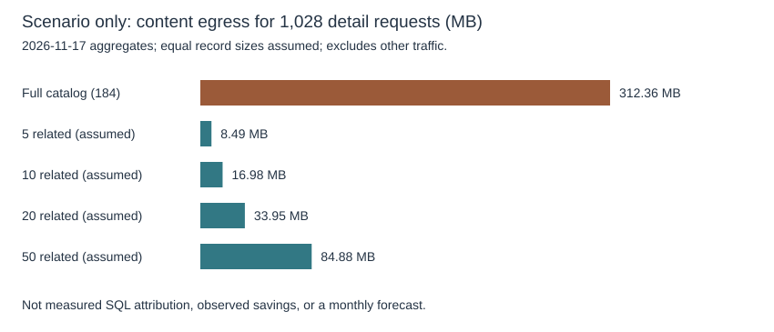

# Neon 流量能否优化

**[结论] 能，而且有明确的代码切入点。优先缩小资源、人物、专题和洞察详情的查询范围；再拆分摘要与详情投影；最后引入带实时可见性校验的版本缓存。不能承诺全站立即降低某个百分比。**

分析日期：2026-11-18，Europe/Berlin。目标是减少 Neon → 网站服务端的数据传输，同时保留当前信号结构、实体关系、全部时间范围和撤回规则。应用基线 `b80a912`；历史量化数据采于 2026-11-17，今日仅核查三个公开页面响应头。完整证据见 [sources.md](../sources.md)。

## 目前真正重复的是什么

[事实] 资源和人物详情经过 `getPublicResourceDetail → getPublicExploration → getSignalEntries → unified list`，先读取所有公开信号，再筛目标实体；随后又读取全部已发布专题洞察的完整 result 来判断关联报告。见 `apps/web/lib/server/resource-detail.ts:9`、`apps/web/lib/unified-signal-reader-core.ts:12`、`apps/web/lib/server/automation-insights.ts:33`。

[事实] 全量 `content` 不是导入文章全文，而是标题、摘要、日期、类型、评分、人物、组织、领域和来源等统一字段。人物/组织里还有简介及来源链接。因此优化的重点是“少读无关信号”和“少传重复关系材料”，不能把删除原始文章当作解决办法。见 `packages/database/src/unified-signal-contract.mjs:70-95`。

[事实] 首页、信号列表、资源目录、专题页和 sitemap 也复用全目录。首页虽然向浏览器传递了精简模型，但精简发生在服务端读库之后，不能减少已经发生的 Neon 传输。今日三个 HEAD 样本均为 `private, no-cache, no-store` 和 `X-Vercel-Cache: MISS`；不是全天命中率统计。

[事实] 当前 React `cache` 避免同一次页面渲染内重复读取；它不会让不同访客共享结果。[React 官方说明](https://react.dev/reference/react/cache)

## 已有优化不应重复计算

- 信号详情已有按 ID 查询，只有旧名称关联等兼容路径可能回退全目录；不是每个详情页都会下载所有信号。
- 页面 metadata 与正文正常共享一次 React 读取；不能把两次函数调用算作两次数据库全量传输。
- unified 搜索的信号、资源和洞察共用一次请求内快照。
- 生成任务进度和自动采集列表已有数据库侧小字段投影；普通轮询是 15 秒、隐藏暂停、无重叠。它们不是每 5 秒读取原始材料。
- 公开页读取的是当前公开集合，不是所有历史版本、导入原件或候选内容。清理历史记录主要节省存储，不会直接消除当前公开目录的重复传输。

## 建议的实施顺序

| 顺序 | 改动                                                                | 为什么优先                                                   | 必须保留的行为                                               |
| ---- | ------------------------------------------------------------------- | ------------------------------------------------------------ | ------------------------------------------------------------ |
| 1    | 资源/人物详情按实体查询；报告详情按证据 ID 批量查询                 | 高频详情不应每次读取全站目录，收益最直接                     | 人物重名歧义、旧名称关联、最新公开简介、跨专题报告的全部证据 |
| 2    | 专题按 Topic 查询；信号卡片、雷达、资源目录、sitemap 使用专用投影   | 从 PostgreSQL 返回前减小数据量                               | 卡片信息、全部时间范围、唯一事件统计、已发布范围与完整性     |
| 3    | 洞察先筛相关报告，再读正文及全部 inputs；搜索在当前公开视图上预筛选 | 避免每个页面下载全部报告；降低目录扩大后的传输               | 报告 digest/version/revision 检查、搜索归一化及排名          |
| 4    | 修正剩余补全页轮询，压缩 ACL 返回结果                               | 消除少数后台页面的重复大字段读取；降低每次公开读取的固定开销 | 不重叠、隐藏暂停；每次仍新查权限，严格检测额外授权           |
| 5    | 公开内容按版本跨请求缓存                                            | 多个访客可以复用未变化内容                                   | 每请求检查权限、就绪与当前公开版本；撤回立即排除             |

[推断] 第一轮可以主要沿用现有只读公开视图，先用 SQL 条件及 JSON 字段投影，不必先删除数据或扩大角色权限。若为性能增加索引或新视图，再按数据库变更流程单独评审。索引能减少计算和扫描时间，但查询返回内容相同时，不会自动减少出口字节。

### 具体兼容约束

1. **实体关系需要全局消歧。** 旧名称记录依赖当前全部公开身份及 Seed 别名。可以先取小型身份目录，再按实体查信号；不能仅匹配一个名字就认定唯一。实体简介也要来自最新仍公开的资料，撤回后须回退。见 `editorial-entity-links.ts:43-85`、`public-exploration-core.ts:325-362`。
2. **洞察需要全部依赖。** 先读目标报告，再批量读其 `inputs`；报告可能引用跨专题或跨实体信号。只拿当前专题的子集去校验，会误删有效报告。现行 digest 包含摘要、人物、来源等字段，不能随意删字段继续使用同一校验。见 `topic-insight-core.ts:61-80,226-255`。
3. **投影需要独立契约。** 当前 unified parser 要求精确完整字段。卡片 DTO、雷达 DTO 和身份目录应有自己的验证器，不应通过缺字段强制转换、填假值或关闭验证来减少数据。列表卡片摘要本身占一定比例，收益需测，不能直接宣称“裁字段节省 90%”。
4. **保持产品范围。** 雷达支持全部时间和自定义窗口；列表要求平铺。不能用最近 30 天或固定 LIMIT 偷换范围。查询分页、懒加载若改变交互，应单独设计；本报告不默认改变页面行为。

## 能省多少：条件估算

[历史事实] 11 月 17 日观测到 184 条公开信号，content 合计 303,852 字节；同日一个 12 小时窗口中，资源和人物详情共有 1,028 次 CDN 请求。

[假设] 每次请求都触发一次目录读取，相关记录平均大小与全目录相同，则该组请求的完整目录内容传输基线是 **312.36 MB**。改为仅取关联信号后：

| 假设每个详情需要的信号数 | 同组请求内容传输估算 | 相对条件基线减少 |
| -----------------------: | -------------------: | ---------------: |
|                        5 |              8.49 MB |            97.3% |
|                       10 |             16.98 MB |            94.6% |
|                       20 |             33.95 MB |            89.1% |
|                       50 |             84.88 MB |            72.8% |

这些数量是敏感性情景，不是已测到的平均关联数量；它们也未计入全局身份目录、报告证据补读、ACL、协议和其他页面。**不能将这组下降比例套到全站 778.94 MB，更不能称为上线后已节省。** 极热门组织若关联大部分信号，单靠按实体筛选收益会下降。

[假设] 另一个独立缓存情景：90% 内容请求命中缓存，每请求仍读取假设为 16 KiB 的当前版本清单，则这组请求预计约 **48.08 MB**，比条件基线降低约 **84.6%**。命中率、元数据大小、并发填充和部署驱逐尚未测量；该情景不能与上表比例相加，且尚未包含 ACL 等固定开销。脚本保留 50%–95% 命中率情景以便复算。

## 为什么不直接给所有页面加缓存

[事实] 当前每次借出只读连接都会检查角色权限，再检查 unified readiness；公开视图只返回当前 head 的 published 版本。人工发布/修改/撤回、自动发布、Workflow 及维护写入都可能改变公开集合。当前没有覆盖这些写路径的业务缓存失效调用。

[推断] 因此固定 TTL、只在网页 handler 清缓存，或整页 CDN 缓存，都可能绕过“撤回后下一请求不可见”和权限变化检查。`revalidateTag(..., 'max')` 还允许提供过期内容并在后台更新，不能当作同步撤回。[Next.js 官方说明](https://nextjs.org/docs/app/api-reference/functions/revalidateTag)

建议分两步：

1. **先保留动态响应和实时权限门禁。** 每请求从同一受约束公开视图获取当前可见 ID、版本及必要发布元数据，只从缓存取对应不可变版本；缺失或新版本才读内容。旧名称派生关系和报告证据资格基于本请求当前集合重新核对，不缓存历史关联结论。缓存键包含数据库环境、读模式、契约/投影版本和内容版本。
2. **以后再评估全局版本号。** 如果希望把清单压成一个小型 epoch，必须在数据库事务中覆盖全部公开信号、洞察和依赖变更，设计并发读取/填充的一致性。仅依赖异步失效通知不能保证提交后下一请求立即生效。缓存 miss、驱逐或不可用回源，权限/readiness 失败仍报错，不返回过期内容。

缓存命中也不能绕过角色核验。对于当前逐列 ACL 比对，可把相同的有效权限集合放入 SQL 双向 `EXCEPT ALL`，返回单个 `safe`，继续检测缺失权限、额外权限、其他 schema、GRANT OPTION、可变表权限、PUBLIC 和继承影响。这减少返回字节，不等于减少数据库权限扫描 CPU。

Vercel 提供跨函数的区域数据缓存，但它是可驱逐、非持久存储，不是公开资格的权威来源。是否使用当前项目的 Data Cache、Runtime Cache 或其他适配器，应在实施时验证，尤其要覆盖本地版与线上多实例。[Vercel 官方说明](https://vercel.com/docs/runtime-cache)

## 后台仍可优化的位置

- `candidate-publication-actions.tsx:386-393` 的补全检查仍每 5 秒 inspect；未用通用可见性轮询器。后端读取 generation 全 snapshot/configuration/result，并读取 enrichment 完整资料。改为状态/修订号接口，状态变化或打开详情时再取完整内容。
- `automatic-publication-refresh.tsx:80-85` 最多三次回读仍包含候选 result，可以只查发布状态；次数有界，优先级较低。
- 自动采集轮询虽然已经裁字段，仍每次查询全部最多 50 个配置和 100 个任务；可以只更新当前活动任务，首次打开或人工刷新再读取历史。合并更新要保留已完成任务，不能把活动子集覆盖整个列表。
- 生成流程的阶段更新也有固定 snapshot/result 重读，但它与高频公开页面不是同一类放大。昨天的任务数量和存量快照不足以证明这是主要流量来源。

## 反面观点、风险与验收

- **归因不完整。** 今天没有重新取生产 SQL 统计；昨日 CDN 请求不等于 SQL 次数。人工 SQL Editor、其他连接、报告体积或后台操作也可能贡献流量。
- **收益有固定下限。** 保留每请求 ACL/readiness/版本清单会产生固定开销；缓存越好，这些占比越明显。不能承诺零数据库流量。
- **数据库计算可能转移而非消失。** JSON 过滤、hash 或 ACL 集合比对会使用数据库 CPU。除了返回字节，还需检查查询耗时、执行计划及 CU 用量。
- **爬虫不是首要阻断对象。** 先让正常公开读取便宜；爬虫照常访问也能受益。直接封锁搜索引擎会影响发现与分享，且不能修复每次读取过大的问题。以后再基于真实异常请求讨论限流。
- **不同流量不要混为一谈。** 图片压缩、浏览器 gzip、部署产物清理、提高连接池上限，分别解决其他问题，不能直接减少现有 SELECT 返回的 Neon 数据。

验收建议：先建立本地/隔离环境的同场景基线，再分阶段上线观察至少两个完整自然日；同时报告每 1,000 个相关详情请求的返回内容字节，避免因访客数或爬虫数变化误判。记录查询类别、次数、行数及字节聚合，不记录正文、搜索词、IP 或完整 SQL 参数。`JSON.stringify` 长度只能标为应用侧估算，不能伪称 PostgreSQL 协议或 Neon 账单字节。

功能回归必须覆盖：新发布、修改、撤回、恢复，旧名称歧义和简介回退，权限被撤销/额外授权、readiness 关闭，多实例缓存和缓存驱逐，以及信号变化后洞察在列表、详情、搜索、sitemap 中同时隐藏。平铺信号与雷达全部时间范围保持一致。

本次复算和资料检查通过不代表优化已上线；所有业务改动仍待实施。
